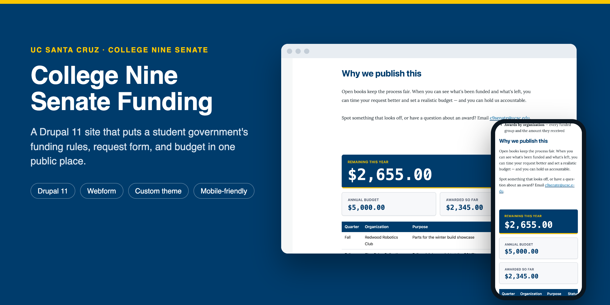
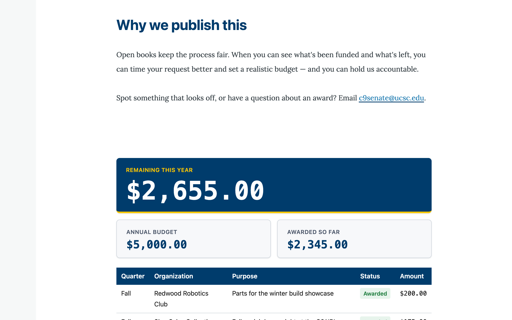
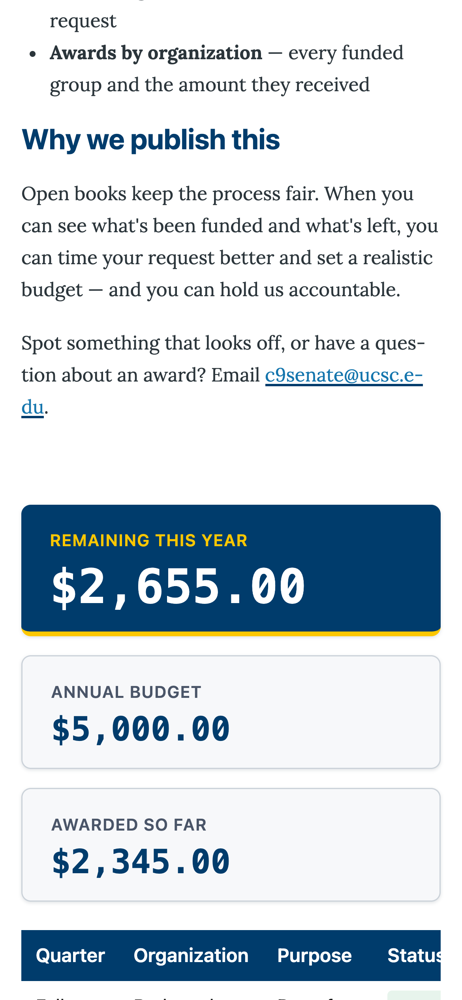
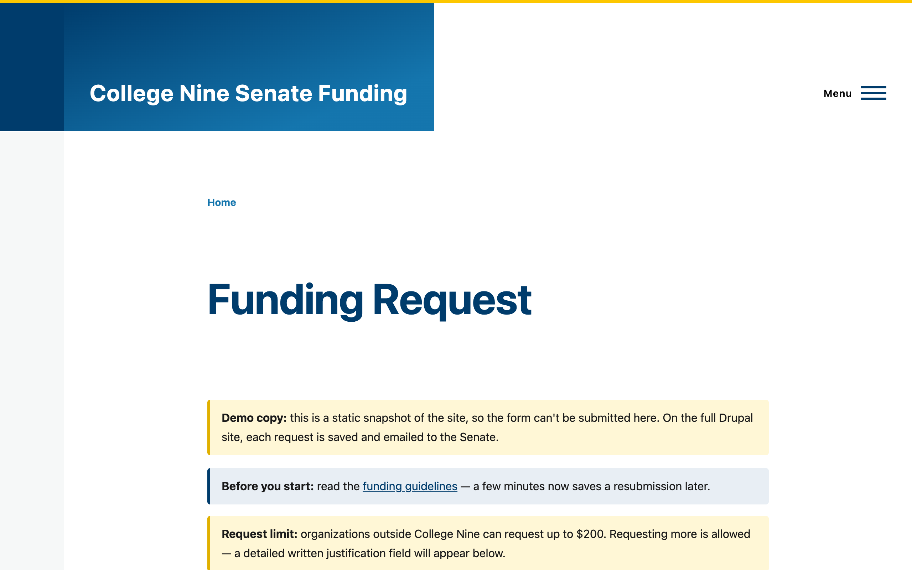
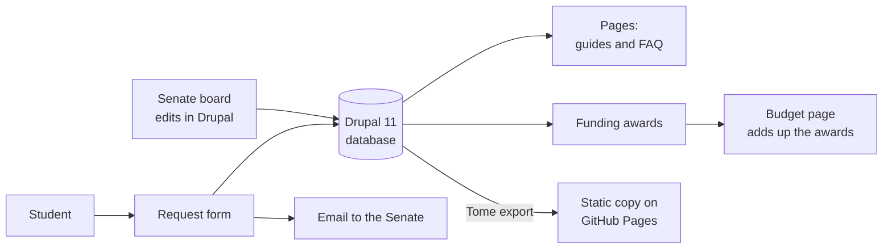

<p align="center">
  
</p>

<h1 align="center">College Nine Senate Funding</h1>

<p align="center">
  A Drupal 11 website for the College Nine Senate at UC Santa Cruz.<br>
  The Senate's funding rules, request form, and budget, in one public place.
</p>

<p align="center">
  <a href="https://kgorle1111.github.io/c9-funding-guide/"><strong>View the live demo</strong></a>
  &nbsp;·&nbsp;
  <a href="#run-it-yourself">Run it yourself</a>
  &nbsp;·&nbsp;
  <a href="#how-it-works">How it works</a>
</p>

> [!NOTE]
> **This is a working demo.** The budget numbers and student organization names are sample data, not real Senate records. The live demo is a static copy of the site, so the request form can't be submitted there. The site has not been adopted by the Senate as its official page.

## Why it exists

Student organizations at UC Santa Cruz can ask the College Nine Senate to help fund their events. That information used to be spread across a Google Site, a Google Form, and email threads. There was also no quick way to see how much of the year's budget had already been given out.

This site puts all of it in one place, written for a club treasurer reading on a phone between classes.

## What's on the site

**A public budget page.** Three numbers at the top: what's left to request this year, the annual budget, and what's been awarded so far. Below them, every funding decision grouped by quarter with subtotals, including requests that were turned down and why. The totals recalculate automatically whenever an award is added or edited.

**A request form that knows the rules.** The funding guidelines are linked at the top. Organizations from outside College Nine can request up to $200. If one asks for more, a box appears asking them to justify the amount, so they find out before submitting instead of after. Each request is saved and emailed to the Senate.

**Plain-language guides.** How to request funding, the funding guidelines, and an FAQ with the questions clubs actually ask.

**Built for phones and for everyone.** The layout adapts to small screens, with the remaining-funds number shown first. Text colors meet the WCAG AA contrast level, photos have alt text, status labels use words and not just color, and form fields show a visible focus outline for keyboard users.

| The budget page | On a phone | The request form |
| :---: | :---: | :---: |
|  |  |  |

## How it works



| Part | What it does | Where it lives |
| --- | --- | --- |
| Funding Award content type | One record per funding decision: organization, quarter, year, amount, status, purpose | Created by `drupal/scripts/create_content_types.php` and `create_funding_award_fields.php` |
| Budget block | Loads every published award, totals them by quarter, subtracts from the annual budget, and draws the cards and table. A cache tag makes it refresh when any award changes. | `web/modules/custom/c9_funding/` |
| Request form | Built with the Webform module. The justification box uses Webform's conditional "states". | `drupal/scripts/create_webform.php` |
| Theme | A sub-theme of Drupal's default Olivero theme, in UCSC blue (`#003c6c`) and gold (`#fdc700`) | `web/themes/custom/c9_senate/` |
| Static export | The Tome module saves every page as plain HTML for free hosting on GitHub Pages | `drupal/scripts/export_static.sh` |

## Run it yourself

You need [DDEV](https://ddev.com) and a Docker runtime (Docker Desktop, OrbStack, or Colima).

```bash
git clone https://github.com/kgorle1111/c9-funding-guide.git
cd c9-funding-guide
ddev start
./drupal/scripts/setup.sh
ddev launch
```

`setup.sh` installs Drupal, creates the content types, adds the sample awards and pages, builds the form, and applies the theme. To sign in as the admin, run `ddev drush uli` and open the link it prints. Emails from the form are caught locally by DDEV's Mailpit (`ddev launch -m`) instead of being sent.

This was last tested from a fresh clone on October 9, 2026, on macOS (Apple silicon) with Colima and DDEV 1.25.4. If you use Colima, clone the repo somewhere inside your home folder, because Colima only shares that folder with Docker by default.

To rebuild the static copy, run `./drupal/scripts/export_static.sh`. It writes the site to `html/`, adds the `/c9-funding-guide` path prefix that GitHub project pages need, and turns off the form's submit button with a note explaining why.

## Known limitations

- **Sample data.** All awards and organization names are made up. Real figures would be published only after Senate board approval.
- **The demo can't take requests.** GitHub Pages only serves files, so the static copy can't receive form submissions or logins. The full Drupal site can.
- **The annual budget is set in code.** It's a constant (`ANNUAL_BUDGET = 5000.00`) in `TransparencyBlock.php`. Making it editable from the admin screen would be the next improvement.
- **Email needs a mail server.** The form is set up to email the Senate, but actually sending mail depends on where the site is hosted.

## Credits

Built by Kannishk Naidu Gorle, VP of Finance for the College Nine Senate, with [Claude](https://claude.ai) (Anthropic) as an AI pair programmer. The photos are from College Nine Senate events. Drupal and its contributed modules are open source under the GPL. See `LICENSE.txt`.
